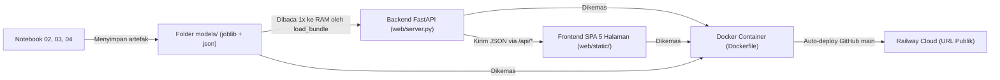

# Panduan Presentasi & Pendalaman Materi Web Engineering — TakarMobil
**Fokus Peran: Implementasi Aplikasi Web, Integrasi Model ML, Kontainerisasi Docker, & Deployment Railway**  
**Pemilik Materi:** Muhamad Ganabitz Dzikri (`J0404241157`) · Kelompok 15 · Kelas B2

> **Tips Buka Cepat Saat Tanya-Jawab di VS Code:** Tekan **`Ctrl + P`** untuk membuka file, lalu tekan **`Ctrl + G`** dan ketik nomor baris yang tercantum di panduan ini agar langsung melompat ke kode pembuktiannya!

---

## Peta Besar: Apa Sebenarnya yang Saya Kerjakan?

Di proyek ini, alur kerjanya terbagi menjadi **dua dunia** yang saling terhubung:
1. **Dunia Data Science (Notebook `01` s.d. `04`)** → menghasilkan file model & laporan di folder `models/`.
2. **Dunia Web & Deployment (Bagian Saya)** → mengambil file-file di `models/`, membungkusnya dengan **REST API FastAPI** (`web/server.py`), membangun **antarmuka web 5 halaman (SPA)** (`web/static/`), mengemas semuanya ke dalam **Docker** (`Dockerfile`), lalu menayangkannya ke internet publik lewat **Railway**.

---

## 0. Peta Bukti Cepat: "Kalau Saya Bilang X, Harus Cek ke File & Baris Mana?"

Gunakan tabel ini sebagai **contekan cepat saat dosen meminta membuktikan kodingan**:

| Klaim yang Anda Ucapkan Saat Presentasi | File yang Dibuka | Baris / Bagian yang Ditunjukkan | Apa yang Terlihat di Sana |
| :--- | :--- | :--- | :--- |
| *"Model XGBoost sudah membungkus preprocessing di dalamnya"* | `notebooks/03_Modeling.ipynb` | **Baris `217–223` & `416` & `632`** | `preprocessor` (`StandardScaler` + `OneHotEncoder`) digabung ke `pipe_xgb = Pipeline(...)` lalu di-`joblib.dump` menjadi `models/xgboost_model.joblib`. |
| *"Daftar merek/model/varian dihasilkan saat preprocessing"* | `notebooks/02_Preprocessing.ipynb` | **Baris `967` & `1002`** | Mengekspor `models/preprocessor.joblib` dan menulis `models/feature_metadata.json`. |
| *"Laporan metrik 5 model & 12 fitur terpenting datang dari evaluasi"* | `notebooks/04_Evaluation.ipynb` | **Baris `703`** | Menulis `models/evaluation_report.json` (`metrics_table` + `top_features`). |
| *"Web cuma me-load model 1 kali ke RAM agar ringan"* | `web/server.py` | **Baris `31–42`** | `@lru_cache(maxsize=1)` pada `load_bundle()` memuat `feature_metadata.json`, `evaluation_report.json`, dan `xgboost_model.joblib`. |
| *"Input user divalidasi & dibersihkan sebelum diprediksi"* | `web/server.py` | **Baris `45–57` & `60–103`** | Class Pydantic `CarSpec` / `DealRequest` dan fungsi `check_choices()` (`resolve_model_name`, `resolve_varian_name`). |
| *"Model memprediksi log-harga lalu dikonversi ke Rupiah + batas ±15%"* | `web/server.py` | **Baris `27–28` & `106–129`** | `TOLERANSI = 0.15`, fungsi `predict_price()` menyusun 9 kolom `DataFrame`, menjalankan `np.expm1(model.predict(frame)[0])`, lalu hitung `batas_bawah` & `batas_atas`. |
| *"Deal Checker membagi harga ke 5 kategori kewajaran"* | `web/server.py` | **Baris `132–157`** | Fungsi `judge_deal()` membagi `selisih_persen` ke ambang `<-20%`, `<-5%`, `<=5%`, `<=20%`, `>20%`. |
| *"Ada 6 API endpoint + fallback SPA agar tidak 404 saat refresh"* | `web/server.py` | **Baris `163–240`** | `/api/meta`, `/api/predict`, `/api/deal`, `/api/curve`, `/api/importance`, `/api/evaluation`, plus `@app.get("/{page:path}")` mengembalikan `index.html`. |
| *"Kelima halaman berada di 1 file HTML dan pindah tanpa reload"* | `web/static/index.html` & `web/static/js/main.js` | `index.html` **baris `22–29` & `52–257`** · `main.js` **baris `5–11` & `57–88`** | 5 `
` di `index.html` dan `ROUTES` + `history.pushState` + `document.startViewTransition` di `main.js`. |
| *"Form & widget interaktif terhubung ke API via fetch"* | `web/static/js/util.js`, `widgets.js`, `features.js` | `util.js` **baris `39–49, 63–78`** · `widgets.js` **baris `618, 645`** · `features.js` **baris `49–307`** | `api()`, `loadMeta()`, `buildSpecForm()`, `moneyWidget()`, dan handler 5 halaman (`initHome`, `mountEstimator`, `mountDeal`, `mountImportance`, `mountAbout`). |
| *"Dulu memang pernah pakai Streamlit sebelum migrasi ke FastAPI"* | `legacy_streamlit/` | `legacy_streamlit/app.py` & folder `pages/` | Arsip 4 halaman Streamlit lama sebagai bukti evolusi arsitektur. |
| *"Aplikasi dikemas Docker & otomatis menyesuaikan `$PORT` Railway"* | `Dockerfile` & `requirements.txt` | `Dockerfile` **baris `1–14`** | `FROM python:3.11-slim`, salin `models/`, `media/`, `web/`, dan `CMD ["sh", "-c", "... --port ${PORT:-7860}"]`. |

---

## 1. Bagaimana Integrasi Model ML Bisa Tampil & Berjalan di Web?

Ini bagian paling penting untuk dipahami agar tidak bingung jika ditanya *"file apa yang dipanggil web, dan bagaimana prediksi bisa muncul?"*.

### A. Peta File di Folder `models/` dan Nasibnya di Web

Di folder `models/`, ada 7 file hasil training/evaluasi notebook. **Tidak semuanya di-load ke RAM web**, supaya server tetap hemat memori dan cepat:

| File di `models/` | Dibuat Di Mana | Dipakai di Web? | Cek di File & Baris | Fungsi Sebenarnya di Sistem |
| :--- | :--- | :---: | :--- | :--- |
| **`xgboost_model.joblib`** | `03_Modeling.ipynb` | **Ya (Utama)** | `03_Modeling.ipynb` baris `416` & `632` → dibaca `web/server.py` baris `41` | **Mesin prediksi utama.** Berupa **Scikit-learn `Pipeline` lengkap** yang di dalamnya sudah tertanam `preprocessor` (`StandardScaler` + `OneHotEncoder`) sekaligus model `XGBRegressor`. |
| **`feature_metadata.json`** | `02_Preprocessing.ipynb` | **Ya** | `02_Preprocessing.ipynb` baris `1002` → dibaca `web/server.py` baris `34–35` | Menyimpan daftar resmi **5 Merek**, **`models_by_brand`**, **`variants_by_model`**, list Wilayah, Transmisi, Bahan Bakar, serta jumlah data (`13.320` bersih, `10.656` train, `2.664` test). |
| **`evaluation_report.json`** | `04_Evaluation.ipynb` | **Ya** | `04_Evaluation.ipynb` baris `703` → dibaca `web/server.py` baris `37–40` | Menyimpan hasil uji 5 model (`metrics_table`: MAE, RMSE, MSE, R²) dan daftar **`top_features`** (12 fitur terpenting XGBoost). |
| `preprocessor.joblib` | `02_Preprocessing.ipynb` | *Tidak langsung* | `02_Preprocessing.ipynb` baris `967` | Arsip preprocessor terpisah. Di web tidak perlu dipanggil lagi karena **sudah ikut dibungkus di dalam `xgboost_model.joblib`**. |
| `ridge_model.joblib`, `random_forest_model.joblib`, `decision_tree_model.joblib`, `training_summary.json` | `03_Modeling.ipynb` | *Tidak di-load ke RAM* | `03_Modeling.ipynb` baris `629–631` | Artefak model pembanding & log training untuk `04_Evaluation.ipynb`. Di web, hasil evaluasinya dibaca ringan dari `evaluation_report.json` tanpa membebani RAM dengan 4 model sekaligus. |

> **Poin Kunci Hafalan:** *"Aplikasi web cukup memuat **3 file** dari folder `models/` di `web/server.py` baris `34–41`: `xgboost_model.joblib` (Pipeline preprocessing + XGBoost), `feature_metadata.json`, dan `evaluation_report.json`."*

---

### B. Alur Teknis Detik-per-Detik Saat User Menekan Tombol "Takar harga"

Bayangkan user memilih **Toyota · Avanza · G · 2020 · 45.000 km · Automatic · Bensin · Jakarta**, lalu menekan **Takar harga**:

1. **Browser (`web/static/js/features.js` baris `82–85`)** mengirim HTTP `POST /api/predict` dan `POST /api/curve` secara paralel (`Promise.all`) lewat helper `api()` (`web/static/js/util.js` baris `39–49`).
2. **FastAPI (`web/server.py` baris `188–191`)** menerima request di `api_predict(spec: CarSpec)` dan memvalidasi tipe/rentang angka memakai **Pydantic** (`class CarSpec` baris `45–53`: `tahun` `1995–2025`, `km` `0–500.000`).
3. **Pencocokan Kategori (`web/server.py` baris `90–103`):** `check_choices()` memverifikasi pilihan terhadap `feature_metadata.json` (`resolve_model_name` baris `60–72` & `resolve_varian_name` baris `75–87`).
4. **Penyusunan Input 9 Kolom (`web/server.py` baris `106–120`):** `predict_price()` menghitung `usia = TAHUN_ACUAN - spec.tahun` (`2025 - 2020 = 5`), lalu membentuk **1 baris `pandas.DataFrame`**:
   - `Usia_Mobil`, `KM_Clean`, `KM_hilang` (`0`), `Merek_Clean`, `Model_Clean`, `Varian_Clean`, `Transmisi_Clean`, `Bahan_Bakar_Clean`, `Wilayah`.
5. **Preprocessing + Prediksi di dalam Pipeline (`web/server.py` baris `121` & `03_Modeling.ipynb` baris `217–223, 416`):**
   - `model.predict(frame)` memanggil **`xgboost_model.joblib`**.
   - Otomatis `preprocessor` menjalankan **`StandardScaler`** pada fitur numerik dan **`OneHotEncoder(min_frequency=5)`** pada fitur kategorikal, lalu diteruskan ke `XGBRegressor`.
   - Keluaran model masih dalam skala **`Log(1 + Harga)`**.
6. **Inversi ke Rupiah & Rentang Wajar (`web/server.py` baris `28 & 121–129`):**
   - `np.expm1(model.predict(frame)[0])` (`e^x - 1`) mengembalikan log-harga menjadi **Rupiah asli**.
   - Dihitung `batas_bawah = price * (1 - 0.15)` dan `batas_atas = price * (1 + 0.15)` (`TOLERANSI = 0.15`).
7. **Render di Browser (`web/static/js/features.js` baris `89–105`):** JSON hasil ditampilkan dengan animasi `countUp`, batang batas tawar `±15%`, dan kurva SVG penyusutan tahunan (`curveSVG()` baris `28–46`).

---

## 2. Pengembangan REST API Menggunakan FastAPI (`web/server.py`)

### Mengapa Memilih FastAPI?
- **Cepat & Ringan:** Berjalan di atas Uvicorn (ASGI), langsung melayani JSON ringan tanpa me-render ulang skrip UI Python di setiap klik user.
- **Validasi Input Otomatis (Pydantic):** `CarSpec` & `DealRequest` (`web/server.py` baris `45–57`) otomatis menolak input tidak valid dengan status HTTP `422`.
- **Dokumentasi Swagger Otomatis:** Didefinisikan di baris `160` (`docs_url="/api/docs"`), sehingga seluruh endpoint bisa langsung dibuka dan diuji di browser lewat URL `/api/docs`.
- **Caching Model di RAM (`@lru_cache(maxsize=1)`):** Baris `31–42` menjamin file `.joblib` dan `.json` hanya dibaca dari disk **1 kali** saat request awal masuk.

### Daftar Lengkap Endpoint di `web/server.py`

| Method & URL | Cek di `web/server.py` | Sumber Data / Aksi | Dipakai Oleh Halaman |
| :--- | :--- | :--- | :--- |
| `GET /api/meta` | **Baris `163–185`** | Baca `feature_metadata.json` + baris XGBoost dari `evaluation_report.json` | Semua dropdown & Beranda (`/`) |
| `POST /api/predict` | **Baris `188–191`** | Validasi `CarSpec` → `predict_price()` → harga tengah + batas ±15% | Estimasi Harga (`/estimasi`) |
| `POST /api/deal` | **Baris `194–198`** | `predict_price()` + `judge_deal()` (baris `132–157`) | Deal Checker (`/deal-checker`) |
| `POST /api/curve` | **Baris `201–219`** | Prediksi batch tahun `2005–2025` untuk spesifikasi mobil terpilih | Grafik kurva di `/estimasi` |
| `GET /api/importance` | **Baris `222–224`** | Ambil `top_features` dari `evaluation_report.json` | Faktor Harga (`/faktor-harga`) |
| `GET /api/evaluation` | **Baris `227–229`** | Ambil `metrics_table` 5 model dari `evaluation_report.json` | Tentang Model (`/tentang`) |
| `GET /{page:path}` | **Baris `236–240`** | Fallback mengembalikan `web/static/index.html` (selain awalan `api/`) | Router SPA 5 halaman |

> **Detail Logika Deal Checker (`judge_deal()`, `web/server.py` baris `132–157`):**
> - `pct < -20%` → **Sangat murah** (`level 0`, `good`)
> - `-20% <= pct < -5%` → **Murah** (`level 1`, `good`)
> - `-5% <= pct <= +5%` → **Wajar** (`level 2`, `fair`)
> - `+5% < pct <= +20%` → **Agak mahal** (`level 3`, `warn`)
> - `pct > +20%` → **Sangat mahal** (`level 4`, `bad`)

---

## 3. Pembuatan Antarmuka SPA — 5 Halaman (`web/static/`)

### Apa Itu SPA dan Bagaimana Cara Kerjanya di Proyek Ini?
**SPA (Single Page Application)** berarti browser hanya mengunduh **1 file HTML** (`web/static/index.html`), lalu perpindahan antar halaman dilakukan di browser oleh JavaScript (`web/static/js/main.js`) tanpa *reload* halaman penuh ke server.

- **Pembagian File Frontend (Modular & Tanpa Build Step React/npm):**
  - `web/static/index.html` → Kerangka 5 `
`, navbar (`baris 22–29`), & footer (`baris 261–291`).
  - `web/static/css/style.css` → Tata letak responsif, tema warna, & animasi UI.
  - `web/static/js/main.js` → Peta `ROUTES` (`baris 5–11`), fungsi pindah halaman `applyRoute()` & `go()` memakai `history.pushState` + `document.startViewTransition` (`baris 57–88`), menu mobile (`baris 101–116`), & kontrol video hero (`baris 20–44 & 119–130`).
  - `web/static/js/util.js` → Helper `api()` (`baris 39–49`), state bersama `spec` (`baris 51–60`), `loadMeta()` (`baris 63–78`), & format Rupiah (`rp`, `jt`, `countUp`).
  - `web/static/js/widgets.js` → Form builder `buildSpecForm()` (`baris 645`) untuk Merek, Model/Varian *searchable*, Tahun, Transmisi, BBM, Wilayah, Kilometer, dan `moneyWidget()` (`baris 618`) untuk harga iklan.
  - `web/static/js/features.js` → Logika masing-masing dari 5 halaman + grafik SVG (`curveSVG` baris `28–46`, `meterSVG` baris `139–146`).

> **Anti-404 Saat Halaman Di-Refresh:** Jika user menekan `F5` langsung di `/estimasi`, FastAPI (`web/server.py` baris `236–240`) menangkap path tersebut dan mengembalikan `index.html`, lalu baris terakhir `main.js` (`go(location.pathname, false)` di baris `132`) membaca URL browser dan langsung menampilkan halaman `/estimasi`.

### Rincian 5 Halaman & Letak Kodenya

| Halaman & Route | Container HTML (`index.html`) | Fungsi JS (`features.js`) | Endpoint API yang Dipanggil |
| :--- | :--- | :--- | :--- |
| **1. Beranda (`/`)** | Baris `52–174` | `initHome()` (baris `275–307`) | `GET /api/meta` |
| **2. Estimasi Harga (`/estimasi`)** | Baris `177–192` | `mountEstimator()` (baris `49–128`) | `POST /api/predict` & `POST /api/curve` |
| **3. Deal Checker (`/deal-checker`)** | Baris `195–210` | `mountDeal()` (baris `131–229`) | `POST /api/deal` |
| **4. Faktor Harga (`/faktor-harga`)** | Baris `213–225` | `mountImportance()` (baris `239–257`) | `GET /api/importance` |
| **5. Tentang Model (`/tentang`)** | Baris `228–257` | `mountAbout()` (baris `260–272`) | `GET /api/evaluation` & `GET /api/meta` |

---

## 4. Kontainerisasi Docker & Deployment Publik di Railway

### A. Mengapa Memakai Docker (`Dockerfile`)?
Agar aplikasi bebas dari masalah *"di laptop jalan, di server error"* akibat perbedaan versi Python, `xgboost`, atau `scikit-learn`. Seluruh kode, model, aset media, dan dependensi (`requirements.txt`) dikunci dalam 1 container image.

Isi [Dockerfile](file:///d:/SEMESTER%205/ML/ML2026_B2_Kelompok%2015_TakarMobil_PrediksiHargaMobilBekas/Dockerfile) (14 baris):
- **Baris `1–3`:** `FROM python:3.11-slim` + `WORKDIR /app` (image Python 3.11 yang ramping).
- **Baris `5–6`:** `COPY requirements.txt .` & `RUN pip install --no-cache-dir -r requirements.txt` (menginstall library lebih dulu agar cache build cepat).
- **Baris `8–10`:** `COPY models/ models/`, `COPY media/ media/`, `COPY web/ web/` (hanya menyalin file produksi yang dibutuhkan web — notebook & CSV mentah tidak ikut dimasukkan sehingga ukuran image ringan).
- **Baris `12–14`:** `EXPOSE 7860` dan `CMD ["sh", "-c", "uvicorn web.server:app --host 0.0.0.0 --port ${PORT:-7860}"]`.

> **Kenapa `CMD` pakai `sh -c` dan `${PORT:-7860}`?**  
> Di Railway, platform menyuntikkan port dinamis lewat environment variable `$PORT`. Pembungkus shell `sh -c` memastikan nilai `$PORT` dibaca oleh Uvicorn saat runtime (tidak terbaca sebagai teks literal `"$PORT"` yang menyebabkan *Healthcheck failure*), dan jika dijalankan lokal tanpa `$PORT`, otomatis memakai port `7860`.

---

### B. Mengapa Memilih Railway + FastAPI + SPA? Kenapa TIDAK Streamlit?

Kita **memang sempat membuat versi Streamlit** (arsipnya masih lengkap di folder `legacy_streamlit/` — `app.py` dan 4 file di `pages/`), lalu **sengaja bermigrasi** ke arsitektur **FastAPI + SPA + Docker + Railway** karena 4 alasan teknis nyata:

| Aspek Perbandingan | Prototipe Lama (`legacy_streamlit/` + Streamlit Cloud) | Arsitektur Final (**FastAPI + SPA + Docker + Railway**) |
| :--- | :--- | :--- |
| **Performa Interaksi** | Setiap klik slider/dropdown memicu **rerun seluruh script Python** dari atas ke bawah. | **SPA + REST API:** browser hanya fetch JSON ringan ke `/api/*` tanpa reload dan tanpa render ulang Python. |
| **Kebebasan Desain UI/UX** | Kaku mengikuti layout widget Streamlit (sulit membuat *View Transitions*, gauge meter SVG 5 zona, video hero fullscreen, & *searchable combobox* kustom). | **Kontrol UI/UX 100% penuh** (`index.html`, `style.css`, SVG animasi kustom) tanpa watermark atau *chrome* bawaan Streamlit. |
| **Stabilitas Hosting (Railway vs Streamlit Cloud)** | Streamlit Cloud gratis sering masuk *sleep mode* ("Zzz / Wake app") dan tidak bisa menjalankan server FastAPI + SPA murni. | **Railway** mendukung **Dockerfile secara native**, langsung **auto-build & auto-deploy dari branch `main` GitHub**, dan menampilkan web **100% utuh** tanpa iframe pembatas. |
| **Arsitektur Industri** | Logic ML & tampilan UI menyatu (*tightly coupled*). | **Decoupled Architecture:** Backend API FastAPI terpisah bersih dari frontend SPA; mudah diintegrasikan dengan aplikasi mobile di masa depan. |

---

## 5. Panduan & Skrip Bicara Saat Presentasi Bagian Web & Deployment

Gunakan urutan berikut sambil membuka web Railway di browser (dan siapkan VS Code di belakang layar bila penguji ingin melihat kode):

1. **Pembukaan Peran (30 detik):**
   > *"Untuk bagian implementasi aplikasi dan deployment, saya bertanggung jawab menjembatani model Machine Learning dari tim Data Science menjadi aplikasi web publik **TakarMobil** menggunakan **FastAPI**, **Single Page Application (SPA)** 5 halaman, **Docker**, dan **Railway**."*
2. **Alasan Migrasi dari Streamlit ke FastAPI + SPA (45 detik):**
   > *"Pada awal proyek kami sempat membuat prototipe memakai Streamlit yang arsipnya masih ada di folder `legacy_streamlit/`. Untuk versi final kami bermigrasi ke **FastAPI + Vanilla JS SPA** karena Streamlit me-rerun script Python di setiap klik dan tampilannya terbatas. Dengan FastAPI + SPA, navigasi 5 halaman jauh lebih responsif dan bebas kustomisasi."*
3. **Cara Integrasi Model ke Web + Tunjuk File (1 menit):**
   > *"Di `web/server.py` baris `31–42`, FastAPI memuat 3 file dari folder `models/` satu kali ke RAM memakai `@lru_cache`: pertama `xgboost_model.joblib` yang di `03_Modeling.ipynb` sudah membungkus `StandardScaler` + `OneHotEncoder` + `XGBRegressor` dalam satu Scikit-learn `Pipeline`; kedua `feature_metadata.json` untuk pilihan merek, model, dan varian; ketiga `evaluation_report.json` untuk metrik 5 model dan 12 fitur terpenting. Saat memprediksi (`web/server.py` baris `106–129`), backend mengubah input menjadi DataFrame 9 kolom, memanggil `model.predict()`, mengembalikan skala log ke Rupiah lewat `np.expm1()`, serta menghitung batas tawar ±15%."*
4. **Demo 5 Halaman SPA + Docker & Railway (1 menit):**
   > *"Di sisi frontend (`web/static/index.html` & `main.js`), seluruh 5 halaman—Beranda, Estimasi Harga, Deal Checker, Faktor Harga, dan Tentang Model—berpindah halus tanpa reload via `history.pushState` dan `View Transitions`. Aplikasi ini kami bungkus ke `Dockerfile` berbasis `python:3.11-slim` (`CMD sh -c` dengan `${PORT:-7860}`), lalu di-deploy ke **Railway** yang terhubung otomatis ke branch `main` GitHub."*

---

## 6. Bank Pertanyaan Penguji + Rujukan File Bukti Langsung

1. **Tanya:** *"Kenapa di `web/server.py` tidak terlihat file `preprocessor.joblib` di-load? Bukankah data mentah harus di-OneHotEncode dulu sebelum masuk XGBoost?"*  
   **Jawab:** *"Betul Pak/Bu, harus di-encode dulu. Kalau kita cek di `notebooks/03_Modeling.ipynb` baris `217–223` dan `416`, objek `preprocessor` (`StandardScaler` + `OneHotEncoder`) sudah dimasukkan langsung ke dalam `pipe_xgb = Pipeline([('preprocessor', preprocessor), ('model', XGBRegressor(...))])` lalu disimpan di baris `632` menjadi `models/xgboost_model.joblib`. Jadi saat `web/server.py` baris `121` memanggil `model.predict(frame)`, preprocessing berjalan otomatis di dalam Pipeline tersebut."*  
   *(Aksi jika diminta cek: buka `notebooks/03_Modeling.ipynb` baris `217, 416, 632` lalu `web/server.py` baris `41 & 121`.)*

2. **Tanya:** *"Kenapa yang di-load di web hanya `xgboost_model.joblib`? Model lain di folder `models/` dipakai di mana?"*  
   **Jawab:** *"Model pembanding (`ridge_model.joblib`, `random_forest_model.joblib`, `decision_tree_model.joblib`) disimpan di `03_Modeling.ipynb` baris `629–631` dan dievaluasi di `04_Evaluation.ipynb`. Di `web/server.py` baris `32–42`, kami sengaja hanya me-load `xgboost_model.joblib` ke RAM agar server Docker tetap ringan, sementara hasil perbandingan ke-5 modelnya ditampilkan instan dari `models/evaluation_report.json` lewat endpoint `/api/evaluation` di baris `227–229`."*  
   *(Aksi jika diminta cek: buka `web/server.py` baris `37–42` & `227–229`, serta `models/evaluation_report.json`.)*

3. **Tanya:** *"Bagaimana Deal Checker menentukan iklan itu Murah, Wajar, atau Sangat Mahal? Tunjukkan kodingannya."*  
   **Jawab:** *"Ada di fungsi `judge_deal()` pada `web/server.py` baris `132–157`. Selisih persentase dihitung dengan `(harga_iklan - market_price) / market_price * 100`, lalu diklasifikasikan menjadi 5 tingkat: di bawah `-20%` Sangat murah, `-20% s.d. -5%` Murah, `-5% s.d. +5%` Wajar, `+5% s.d. +20%` Agak mahal, dan di atas `+20%` Sangat mahal."*  
   *(Aksi jika diminta cek: buka `web/server.py` baris `132–157` dan visual gauge-nya di `web/static/js/features.js` baris `139–204`.)*

4. **Tanya:** *"Apa bukti web ini SPA 5 halaman dan tidak error kalau di-refresh?"*  
   **Jawab:** *"Bisa dilihat di `web/static/index.html` baris `52–257` yang memuat kelima `
` dalam satu HTML, dan `web/static/js/main.js` baris `5–11` serta `57–88` yang mengatur `history.pushState`. Jika user me-refresh di tengah URL `/estimasi`, route catch-all `@app.get("/{page:path}")` di `web/server.py` baris `236–240` mengembalikan `index.html`, lalu `main.js` baris `132` langsung membuka tab yang sesuai."*  
   *(Aksi jika diminta cek: buka `web/static/js/main.js` baris `5–11, 57–88, 132` dan `web/server.py` baris `236–240`.)*

5. **Tanya:** *"Kenapa pakai Docker + Railway dan bukan Streamlit Cloud?"*  
   **Jawab:** *"Kami memisahkan API backend (`FastAPI`) dan frontend (`SPA`) supaya performa cepat dan UI leluasa — yang arsip Streamlit lamanya masih ada di `legacy_streamlit/`. Streamlit Cloud tidak bisa menjalankan arsitektur custom FastAPI + SPA ini dan sering sleep mode. Dengan `Dockerfile` (`baris 1–14`) dan `CMD sh -c` (`${PORT:-7860}`), **Railway** bisa auto-build langsung dari GitHub `main` dan menayangkan aplikasi 100% utuh."*  
   *(Aksi jika diminta cek: buka `Dockerfile` baris `1–14` dan folder `legacy_streamlit/`.)*

6. **Tanya:** *"Kalau ada perubahan di GitHub (misal perbaikan model atau UI), apakah web di Railway otomatis berubah?"*  
   **Jawab:** *"Ya, otomatis. Service di Railway terhubung ke branch `main` GitHub. Setiap ada `git push` ke `main`, Railway otomatis memicu `docker build` baru berdasarkan `Dockerfile` dan mengganti container lama begitu healthcheck sukses."*
